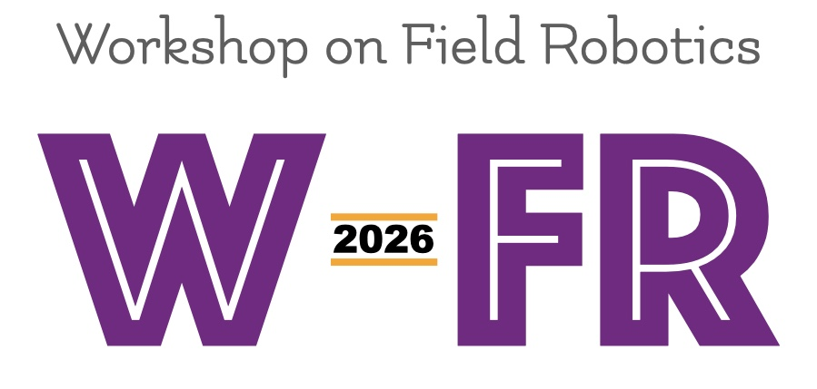
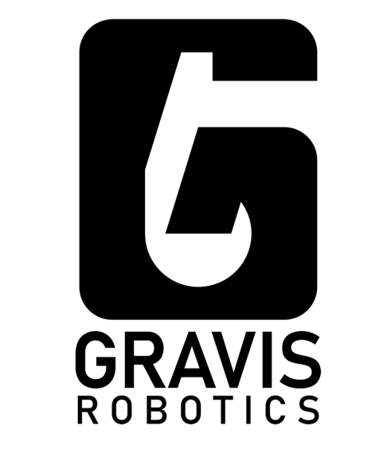
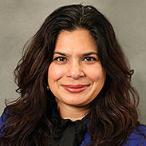
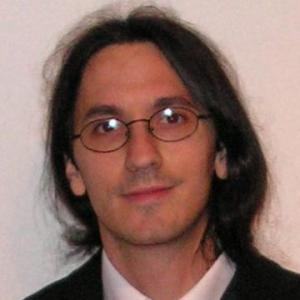
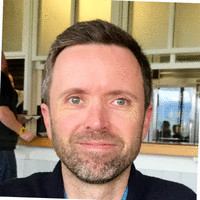
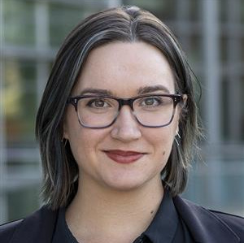
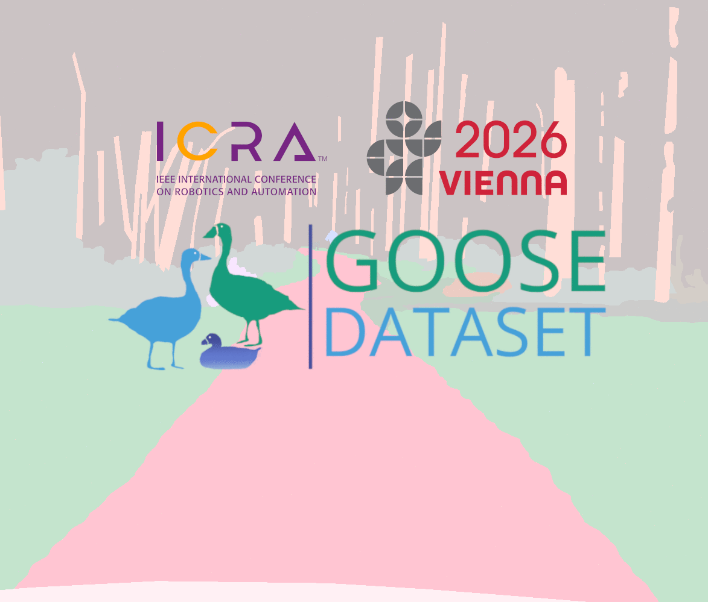
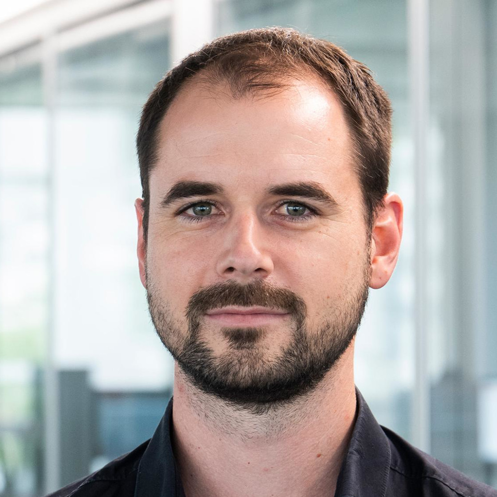
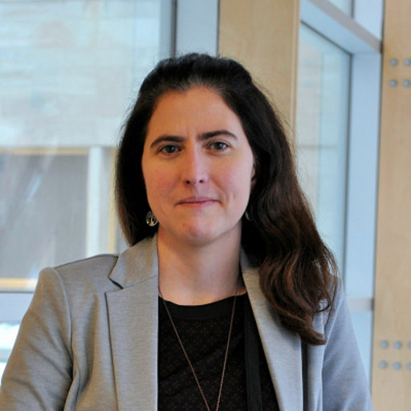

<table style="width: 55%;">
  <tr>
    <td style="width: 20%;"><strong>Sponsored by <a href="https://www.gravisrobotics.com/">Gravis Robotics</a> </strong></td>
    <td style="width: 35%; text-align: center;">
    
    </td>
  </tr>
</table>

## Thanks!

The workshop on Field Robotics 2026 is over and was a tremendous success! We received many contributions, out of which the presented posters are listed in the following section.

## Posters
|  |
|:---|
| **[A Novel Trajectory Evaluation Metric: Distance Travelled Error (DTE)](https://norlab.ulaval.ca/icra_workshop_field_robotics/posters/45.pdf)** Effie Daum (Université Laval)*; Daniele De Martini (Oxford Robotics Institue, Oxford University); François Pomerleau (Université Laval) |
| **[A Tracked Robot for Proximal Ecological Sensing in Coastal Dune](https://norlab.ulaval.ca/icra_workshop_field_robotics/posters/41.pdf)** Francesco Iotti (Università di Pisa)*; Giovanni Di Lorenzo (Università di Pisa); Gabriele Gambino (Università di Pisa); Franco  Angelini (Università di Pisa); Manolo Garabini (Università di Pisa) |
| **[An Open-Source LiDAR and Monocular Off-Road Autonomous Navigation Stack](https://norlab.ulaval.ca/icra_workshop_field_robotics/posters/21.pdf)** Quentin Picard (AMIAD)*; Remi Marsal (ENSTA); Adrien Poiré (ENSTA); Sébastien Kerbourc'h (ENSTA); Thibault Toralba (ENSTA); Clément Yver (ENSTA); Alexandre Chapoutot (ENSTA); David Filliat (AMIAD) |
| **[Benchmarking Robots for Everyday Environments: From Lab Experiments to Real-World Operations](https://norlab.ulaval.ca/icra_workshop_field_robotics/posters/15.pdf)** Raphael Memmesheimer (University of Bonn)*; Martina  Overbeck (FZI Forschungszentrum Informatik); Dominik  Beyer (FZI Forschungszentrum Informatik); Björn  Kral (FU Berlin); Sabine  Bellmann (FZI Forschungszentrum Informatik); Tristan Schnell (FZI Forschungszentrum Informatik); Christoph  Zimmermann ( 	FZI Forschungszentrum Informatik); Benedikt  Pulver (TÜV SÜD Product Service GmbH); Wilhelm  Stork (FZI Forschungszentrum Informatik / Institute for Information Processing Technologies, Karlsruhe Institute of Technology,); Sven  Behnke (University of Bonn); Arne Rönnau (FZI Forschungszentrum Informatik, Machine Intelligence and Robotics Lab, Karlsruhe Institute of Technology) |
| **[Combining Robot Experience with Human Expertise for State-Dependent Traversability Estimation](https://norlab.ulaval.ca/icra_workshop_field_robotics/posters/38.pdf)** Andre Schreiber (University of Illinois Urbana-Champaign)*; Katherine Driggs-Campbell (University of Illinois Urbana-Champaign) |
| **[COMPASS: Learning Global Spatial Context for Long-Range Goal Navigation](https://norlab.ulaval.ca/icra_workshop_field_robotics/posters/61.pdf)** Jose Lavariega (ETH Zurich)*; Erica Tevere (NASA Jet Propulsion Laboratory); Patrick Spieler (NASA Jet Propulsion Laboratory) |
| **[Cross-View Localization Beyond Urban Environments via Metric-Semantic Primitive Matching](https://norlab.ulaval.ca/icra_workshop_field_robotics/posters/55.pdf)** Mason Peterson (MIT)*; Qingyuan Li (MIT); Yixuan Jia (MIT); Fernando Cladera (University of Pennsylvania); Camillo Taylor (University of Pennsylvania); Jonathan How (MIT) |
| **[CurviTrack: Curvilinear Trajectory Tracking for High-Speed Chase of a USV](https://norlab.ulaval.ca/icra_workshop_field_robotics/posters/3.pdf)** Parakh Gupta (MRS Lab, CTU, Prague)*;  Ondřej Procházka (Multi-Robot Systems Lab, Czech Technical University, Prague); Tiago Nascimento (Universidade Federal da Paraíba); Martin Saska (Multi-Robot Systems Lab, Czech Technical University, Prague) |
| **[Degradation-resistant Lidar-inertial-vision Odometry for Ultra-long Undersea Tunnels](https://norlab.ulaval.ca/icra_workshop_field_robotics/posters/66.pdf)** Jiong Ding (Beihang University)* |
| **[Depth-Aware Distillation: Lightweight depth features for localization in natural environments](https://norlab.ulaval.ca/icra_workshop_field_robotics/posters/69.pdf)** Walter Nedov (CSIRO); Saimunur Rahman (CSIRO Data61)*; Kavindie Katuwandeniya (CSIRO); David Hall (CSIRO); Kaushik Roy (CSIRO); Peyman Moghadam (CSIRO) |
| **[Did We Need to Reinvent the Wheel? Lidar-level SE(3) Odometry with an Encoder and a Gyroscope](https://norlab.ulaval.ca/icra_workshop_field_robotics/posters/35.pdf)** Cedric Le Gentil (University of Toronto)*; Daniil Lisus (University of Toronto); Katya M. Papais (University of Toronto); Timothy D. Barfoot (University of Toronto) |
| **[Field evaluation of robotic under-canopy drones in boreal forest](https://norlab.ulaval.ca/icra_workshop_field_robotics/posters/14.pdf)** Väinö Karjalainen (Finnish Geospatial Research Institute)*; Aleksi Karhunen (Finnish Geospatial Research Institute); Guglielmo Del Col (Finnish Geospatial Research Institute); Teemu Hakala (Finnish Geospatial Research Institute); Eija Honkavaara (Finnish Geospatial Research Institute) |
| **[Field-Deployable Quadrupedal Locomotion over Risky Gap Terrains Using Single-LiDAR Elevation Mapping](https://norlab.ulaval.ca/icra_workshop_field_robotics/posters/9.pdf)** Wanyue Li (The University of Hong Kong)*; Yinzhao Dong (The University of Hong Kong); Ji Ma (The University of Hong Kong); Peng Lu (	The University of Hong Kong) |
| **[FootRecon: Quadrupedal Terrain Reconstruction from Sparse Foot Contacts with Geometric Prior](https://norlab.ulaval.ca/icra_workshop_field_robotics/posters/68.pdf)** Yujin Park (UNIST)*; Seungoh Han (UNIST); Taebok Lee (Kookmin University ); Chanwoo Lee (UNIST); Hyungyu Park (UNIST); Kyungdon Joo (UNIST) |
| **[From Natural Language to Outdoor Autonomy via Structured Reasoning in Hierarchical Scene Graphs](https://norlab.ulaval.ca/icra_workshop_field_robotics/posters/64.pdf)** Harel Biggie (Massachusetts Institute of Technology)*; Jacob Arkin (Massachusetts Institute of Technology); Jaeyoun Choi (Massachusetts Institute of Technology); Andrew Fishberg (Massachusetts Institute of Technology); Nathan Hughes (Massachusetts Institute of Technology); Travis Manderson (Massachusetts Institute of Technology); Aryan Naveen (Massachusetts Institute of Technology); Mason Peterson (Massachusetts Institute of Technology); Aaron Ray (Massachusetts Institute of Technology); Akila Saravanan (Massachusetts Institute of Technology); Yasmin Veys (Massachusetts Institute of Technology); Ruihan (Multy) Xu (Massachusetts Institute of Technology); Claire Bonial (Army Research Laboratory (ARL), USA); Carlos Nieto-Granda (Army Research Laboratory (ARL), USA); Long Quang (Army Research Laboratory (ARL), USA); Ethan Stump (Army Research Laboratory (ARL), USA); Chuchu Fan (Massachusetts Institute of Technology); Luca Carlone (Massachusetts Institute of Technology); Jonathan How (Massachusetts Institute of Technology); Nicholas Roy (Massachusetts Institute of Technology) |
| **[GrandTour Dataset-X: A robotic expedition at Mt. Etna](https://norlab.ulaval.ca/icra_workshop_field_robotics/posters/22.pdf)** Turcan Tuna (ETH Zurich)*; Julia Richter (ETH Zurich); Marco Hutter (ETH Zurich) |
| **[Ground Plane to Grading: A Terrain Feature Perception Baseline for Autonomous Motor Grading in Mining](https://norlab.ulaval.ca/icra_workshop_field_robotics/posters/34.pdf)** Sina Qahremani (Queen's University )*; Keyvan Hashtrudi-Zaad (Queen's University ); Joshua Marshall (Queen's University ) |
| **[Heterogeneous Robot Collaboration in Unstructured Environments with Grounded Generative Intelligence](https://norlab.ulaval.ca/icra_workshop_field_robotics/posters/40.pdf)** Zachary Ravichandran (University of Pennsylvania)*; Fernando Cladera (University of Pennsylvania); Ankit Prabhu (University of Pennsylvania); Jason Hughes (University of Pennsylvania); Carlos Nieto-Granda (U.S. Army Research Laboratory (ARL)); Varun Murali (Texas A&M University); Camillo Taylor (University of Pennsylvania); George Pappas (University of Pennsylvania); Vijay Kumar (University of Pennsylvania) |
| **[Hitting Rock Bottom! A Lab-to-Field Pipeline for Subsurface Reconstruction](https://norlab.ulaval.ca/icra_workshop_field_robotics/posters/53.pdf)** Unal Artan (Orebro University)*; Paolo Forte (Orebro University); Franziska Klügl (Orebro University); Andreas Erséus (Volvo Construction Equipment); Bobbie Frank (Volvo Construction Equipment) |
| **[HortiMulti: A Multi-Sensor Dataset for Localisation and Mapping in Horticultural Polytunnels](https://norlab.ulaval.ca/icra_workshop_field_robotics/posters/18.pdf)** Shuoyuan Xu (Loughborough University); Zhipeng Zhong (Loughborough University); Tiago Barros (University of Coimbra); Matthew Coombes (Loughborough University)*; Cristiano Premebida (University of Coimbra); Hao Wu (Antobot Ltd); Cunjia Liu (Loughborough University) |
| **[How Can Aerial Field Robots Use AI to Switch Between Multi-Sensor Mapping Algorithms On the Fly?](https://norlab.ulaval.ca/icra_workshop_field_robotics/posters/25.pdf)** Nirasha Herath (Memorial University of Newfoundland)*; Oscar De Silva (Memorial University of Newfoundland); Thumeera Wanasinghe (Memorial University of Newfoundland); George Mann (Memorial University of Newfoundland); Raymond Gosine (Memorial University of Newfoundland) |
| **[Hybrid Path Planning for Long Lunar Traverse: Field Testing in a Lunar Analogue](https://norlab.ulaval.ca/icra_workshop_field_robotics/posters/71.pdf)** Alexander Krawciw (University of Toronto)*; Benjamin Hockman (Jet Propulsion Laboratory, California Institute of Technology); Michael Paton (Jet Propulsion Laboratory, California Institute of Technology); William Reid (Jet Propulsion Laboratory, California Institute of Technology); Ashish Goel (Jet Propulsion Laboratory, California Institute of Technology); Brandon Rothrock (Jet Propulsion Laboratory, California Institute of Technology); Arthur Bouton (Jet Propulsion Laboratory, California Institute of Technology); Jeff Delaune (Jet Propulsion Laboratory, California Institute of Technology); Sriramya Bhamidipati (Jet Propulsion Laboratory, California Institute of Technology); Timothy Barfoot (University of Toronto); Issa Nesnas (Jet Propulsion Laboratory, California Institute of Technology) |
| **[Improving SfM for Compact Multi-Camera Robots in Low-Light Environments](https://norlab.ulaval.ca/icra_workshop_field_robotics/posters/47.pdf)** Stefano Mutti (SUPSI-DTI)*; Diego Gitardi (SUPSI); Simone Sabbadini (SUPSI); Anna Valente (SUPSI) |
| **[Inferring Terrain Stability from Proprioceptive Data of a Quadruped Robot](https://norlab.ulaval.ca/icra_workshop_field_robotics/posters/44.pdf)** Jean-Michel Fortin (Université Laval)*; Daniele De Martini (University of Oxford); François Pomerleau (Université Laval); Philippe Giguère (Université Laval) |
| **[Informative Trajectory Planning for Search and Capture of Drifting Targets with ASVs](https://norlab.ulaval.ca/icra_workshop_field_robotics/posters/39.pdf)** Sanjeev Kumar Ramkumar Sudha (Norwegian University of Science and Technology)*; Marija Popović (Delft University of Technology); Erlend Coates (Norwegian University of Science and Technology) |
| **[Interior Corner Transitions with a Magnetic-Wheeled Inspection Robot](https://norlab.ulaval.ca/icra_workshop_field_robotics/posters/67.pdf)** Nathaniel Klein (Robomechanics Lab)*; Jessica Wallace (Robomechanics Lab); Paul Nadan (Robomechanics Lab) |
| **[Into the Uncharted with Confidence: Online System Identification for Driving on Unseen Terrains](https://norlab.ulaval.ca/icra_workshop_field_robotics/posters/37.pdf)** Kai Wang (Queen's University at Kingston)*; Sidney Givigi (Queen's University at Kingston); Joshua  Marshall (Queen's University at Kingston) |
| **[Kilometer-Scale GNSS-Denied UAV Navigation via Heightmap Gradients: A Winning System from the SPRIN-D Challenge](https://norlab.ulaval.ca/icra_workshop_field_robotics/posters/49.pdf)** Michal Werner (Czech Technical University in Prague)*; David Čapek (Czech Technical University in Prague); Tomáš Musil (Czech Technical University in Prague); Ondrej Franek (	Czech Technical University in Prague); Tomáš Báča (Czech Technical University in Prague); Martin Saska (	Czech Technical University in Prague) |
| **[Learning Humanoid Locomotion on Granular Terrain](https://norlab.ulaval.ca/icra_workshop_field_robotics/posters/48.pdf)** Junnosuke Kamohara (Georgia Institute of Technology)*; Feiyang Wu (Georgia Institute of Technology); Andy Ningan Zong (Georgia Institute of Technology); Cheng-Yuan Li (Georgia Institute of Technology); Daniel I. Goldman (Georgia Institute of Technology); Yashwanth Nakka (Georgia Institute of Technology); Seth Hutchinson (Northeastern University); Ye Zhao (Georgia Institute of Technology) |
| **[Learning to select frontiers for large-scale exploration](https://norlab.ulaval.ca/icra_workshop_field_robotics/posters/59.pdf)** Jean-François Tremblay (McGill University)*; Edwin Meriaux (McGill University); Andrew Holliday (McGill University); Gregory Dudek (McGill University); David Meger (McGill University) |
| **[Lessons Learned from Mount Etna: Autonomous Gas Monitoring for Volcanic Environments with a Legged Robot](https://norlab.ulaval.ca/icra_workshop_field_robotics/posters/62.pdf)** Julia Richter (Robotic Systems Lab ETHZ)*; Marco Hutter (Robotic Systems Lab ETHZ) |
| **[LiDAR-based Quadrotor Autonomous Inspection System in Cluttered Environments](https://norlab.ulaval.ca/icra_workshop_field_robotics/posters/12.pdf)** Wenyi Liu (The University of Hong Kong)*; Liuyu Shi (The University of Hong Kong) |
| **[Long-Term Inspection in GNSS-Denied Environments Using a Tethered System](https://norlab.ulaval.ca/icra_workshop_field_robotics/posters/54.pdf)** Simon Martínez-Rozas (Universidad de Antofagasta)*; David Alejo Teissiere (Universidad de Sevilla); Fernando Caballero Benitez (Universidad Pablo de Olavide); Luis Merino Cabañas (Universidad Pablo de Olavide) |
| **[Low-Cost Acoustic Localization for Small-Scale Underwater Vehicles: Motion-Constrained Path-Planning](https://norlab.ulaval.ca/icra_workshop_field_robotics/posters/30.pdf)** Moritz Graf (Technical University of Munich)*; Daniel-Andre Dücker (Technical University of Munich) |
| **[Modular Sim-to-Real Evaluation of Zero-Shot RL Policy Transfer: Toward Reproducible Field Testing of Perception and Control Integration](https://norlab.ulaval.ca/icra_workshop_field_robotics/posters/36.pdf)** Luis Batista (Georgia Tech & Université de Lorraine)* |
| **[MUDMAX: A Multimodal Dataset for Multi-Purpose Autonomous Excavator Research](https://norlab.ulaval.ca/icra_workshop_field_robotics/posters/33.pdf)** Younghun Cho (KIMM)*; Baekdong Cha (KIMM); Byeongjin Kim (KIMM); Hanmin Lee (KIMM) |
| **[Multi-Sensor SLAM in Antarctic Ice Fields: A Field Report](https://norlab.ulaval.ca/icra_workshop_field_robotics/posters/56.pdf)** Theekshana Wijewardhana (Memorial University of Newfoundland)*; Oscar De. Silva (	Memorial University of Newfoundland) |
| **[Open-Water Acoustic Self-Localization for AUVs: A Scalable Approach for Compact AUV-ASV Operations](https://norlab.ulaval.ca/icra_workshop_field_robotics/posters/28.pdf)** Yuki Sekimori (Institute of Industrial Science, The University of Tokyo)*; Marie Angelyn Mercado (Institute of Industrial Science, The University of Tokyo); Yang Weng (Institute of Industrial Science, The University of Tokyo); Takumi Matsuda (School of Science and Technology, Meiji University); Toshihiro Maki (Institute of Industrial Science, The University of Tokyo) |
| **[Overcoming Nature: Perception for Autonomous Navigation in  Dense Vegetation](https://norlab.ulaval.ca/icra_workshop_field_robotics/posters/29.pdf)** Lukas Wimmer (Graz University of Technology); Andre Koczka (Graz University of Technology)*; Gerald Steinbauer-Wagner (Graz University of Technology) |
| **[RVC-NMPC: Nonlinear Model Predictive Control with Reciprocal Velocity Constraints for Mutual Collision Avoidance in Agile UAV Flight](https://norlab.ulaval.ca/icra_workshop_field_robotics/posters/32.pdf)** Vit Kratky (Czech Technical University in Prague)*; Robert Penicka (Czech Technical University in Prague); Parakh M. Gupta (Czech Technical University in Prague); Ondrej Prochazka (Czech Technical University in Prague); Martin Saska (Czech Technical University in Prague) |
| **[Sapling-NeRF: Geo-Localised Sapling Reconstruction in Forests for Ecological Monitoring](https://norlab.ulaval.ca/icra_workshop_field_robotics/posters/10.pdf)** Miguel Ángel Muñoz-Bañón (Universidad de Alicante)*; Nived Chebrolu (Indian Institute of Technology, Bombay); Sruthi M. Krishna Moorthy (University of Oxford); Yifu Tao (University of Oxford); Fernando Torres (Universidad de Alicante); Roberto Salguero-Gómez (University of Oxford); Maurice Fallon (University of Oxford) |
| **[Semantic-driven Alignment for Robust Vision-LiDAR Sensor Fusion in Off-Road 3D Segmentation](https://norlab.ulaval.ca/icra_workshop_field_robotics/posters/50.pdf)** David Pascual-Hernández (Universidad Rey Juan Carlos)*; Roberto Calvo-Palomino (Universidad Rey Juan Carlos); Inmaculada Mora-Jiménez (Universidad Rey Juan Carlos); Jose María Cañas-Plaza (Universidad Rey Juan Carlos) |
| **[Side-Scan Sonar SLAM Using Ping-Level Landmark Detection in Feature-Poor Seabed Environments](https://norlab.ulaval.ca/icra_workshop_field_robotics/posters/2.pdf)** Seonghun Hong (Keimyung University)*; Jinho Im (Keimyung University) |
| **[Terrain Map-Conditioned VLAs for Autonomous Earthmoving: Preliminary Findings](https://norlab.ulaval.ca/icra_workshop_field_robotics/posters/58.pdf)** Brian Blankenau (ERDC-CERL); Arturo Saucedo (ERDC-CERL); William Wagner (ERDC-CERL)*; Isaac Blankenau (rerun.io); Dustin Nottage (ERDC-CERL); Ahmet Soylemezoglu (ERDC-CERL) |
| **[These Backflips Aren’t Just for Show: Learned Hydrobatics for Efficient 3D Underwater Mapping](https://norlab.ulaval.ca/icra_workshop_field_robotics/posters/65.pdf)** Lauritz Fosso (SINTEF Ocean); Sverre Herland (SINTEF Ocean); Sveinung Ohrem (SINTEF Ocean); Marios Xanthidis (SINTEF Ocean)* |
| **[Towards high mobility in snow : Analyzing the effect of center of mass on deep snow locomotion](https://norlab.ulaval.ca/icra_workshop_field_robotics/posters/27.pdf)** Mathis Turgeon-Roy (Université Laval)* |
| **[Towards Planetary Drilling Autonomy using Subsurface Fault and Anomaly Detection](https://norlab.ulaval.ca/icra_workshop_field_robotics/posters/11.pdf)** Sarah Boelter (University of Minnesota)*; Greta  Brown (University of Minnesota); Thomas Stucky (KBR); Rene Mai (Rensselaer Polytechnic Institute); Ebasa Temesgen (University of Minnesota); Lucas Weber (Friedrich-Alexander-Universitat Erlangen-Nurnberg); Marybeth Wilhelm (NASA Ames Research Center); Maria Gini (University of Minnesota); Brian Glass (NASA Ames Research Center) |
| **[Tractor Perception Dataset](https://norlab.ulaval.ca/icra_workshop_field_robotics/posters/7.pdf)** Sebastian Zürner (University Leipzig)*; Lorenz Gunreben (University Leipzig); Nepomuk Kindermann (University Leipzig); Nico Heider (University Leipzig); Martin Schieck (University Leipzig); Bogdan Franczyk (University Leipzig) |
| **[Traversing the Untraversable: Enabling UAV Navigation in the Extremely Dense Wild by Contact-driven Adaptation](https://norlab.ulaval.ca/icra_workshop_field_robotics/posters/6.pdf)** Liuyu Shi (The University of Hong Kong)* |
| **[Twist, Store, Release: Investigating the Spring-like Behavior of Heavy Skid-Steer Robot Turning](https://norlab.ulaval.ca/icra_workshop_field_robotics/posters/72.pdf)** William Fecteau (Université Laval)*; Nicolas Samson (Université Laval); Mohamed Ounally (Université Clermont-Auvergne); François Pomerleau (Université Laval) |
| **[Vines to the Rescue Integration of Soft Robotics in Urban Search & Rescue](https://norlab.ulaval.ca/icra_workshop_field_robotics/posters/24.pdf)** Antonio Alvarez Valdivia (Massachusetts Institute of Technology); Ciera McFarland (University of Notre Dame); Ankush Dhawan (Stanford University); Chad Council (Massachusetts Institute of Technology); Margaret McGuinness (University of Notre Dame); Nathaniel Hanson (Massachusetts Institute of Technology)* |
| **[WildOS: Open Vocabulary Object Search in the Wild](https://norlab.ulaval.ca/icra_workshop_field_robotics/posters/13.pdf)** Hardik Shah (ETH Zurich); Manthan Patel (ETH Zurich)*; Erica Tevere (JPL); Marcel Kaufmann (JPL); Deegan Atha (Field AI); Shehryar Khattak (Field AI); Marco Hutter (ETH Zurich); Jonas Frey (Stanford University); Patrick Spieler (JPL) |

## Important dates

- Submission deadline: April 26, 2026, 11:59 p.m. (Anywhere on Earth)
- Poster notification of acceptance:  May 11, 2026
- Spotlight talks notification of acceptance: May 12, 2026
- Workshop date: June 5, 2026

The best submissions will be invited to submit a full-length paper in a Special Issue of the [IEEE Transactions on Field Robotics](https://www.ieee-ras.org/publications/t-fr).

- Official Invitations sent: September-October 2026
- Deadline of submission to IEEE T-FR: February 2027

# Context

Field robotics tackles the problem of developing, deploying, and evaluating autonomous mobile systems in unstructured and often dynamic environments. Typical commercial applications are in agriculture, construction, mining, and forestry. The range of physical mediums is also very diversified: in the air, on the ground, underground, on the water, and underwater. These can be located on Earth, or on other celestial bodies (e.g., planets, moons, or asteroids). As such, field robotics works under wildly diverse and radically different assumptions than other areas of robotics, which tend to have well-defined working hypotheses. Therefore, this creates its own set of challenges. This workshop will thus offer the opportunity to present work and discuss how these unique challenges can be solved.

This workshop will bring together experts, researchers, and practitioners to discuss the latest advancements in field robotics. Participants will gain valuable insights into the challenges and opportunities that arise in deploying robots in diverse field scenarios, such as rugged terrains, remote locations, and hazardous environments. Practical case studies and real-world applications will be presented to showcase the successful, and not-so-successful cases of field robotics. The workshop will encourage fruitful dialogues and collaborative discussions, culminating by a panel at the end of the workshop. Attendees will leave with a comprehensive understanding of the state-of-the-art technologies, the main actors, and upcoming challenges. As major outcomes, we aim to consolidate the community around field robotics and prepare an editorial article on the current status of robotics deployed in real environments.

 

# Program
All invited speakers are confirmed.

| **Time**                | **Speaker**                                | **Topic/title**                                                                 |
|---------------------|----------------------------------------|------------------------------------------------------------------------------|
| 8:45- 9:20     | Organizers                      | Welcome and opening remarks |
| 9:20- 9:50     | **Tim Barfoot** (University of Toronto) | Invited talk #1 - **Lunar Cargo Logistics: Multi-Robot Cooperative Transport on the Moon** |
| 9:50- 10:10     | Five emerging researchers       | Spotlight talks (3 min/pers) |
| 10:10- 11:10    | Coffee break and poster session                               | - |
| 11:10- 11:40   | **Cédric Pradalier** (Georgia Tech Europe) | Invited talk #2 - **Autonomous Robotic Inspection on Ship Hulls and Storage Tanks** |
| 11:40- 12:00   | Organizers                      | Result announcement for the dataset competition |
| 12:00- 13:20   | Lunch                              |  - |
| 13:20- 14:20   | **Nicholas Roy** (MIT)    | Keynote - **Scaling field robotics in the age of LLMs** |
| 14:20- 14:50   | Panel                           | - |
| 14:50- 15:10   | Five emerging researchers       | Spotlight talks (3 min/pers) |
| 15:10- 16:10   | Coffee break and poster session                               | - |
| 16:10- 16:40   | **Nina Mahmoudian** (Purdue University) | Invited talk #3 - **Field-deployable maritime autonomy through energy-aware planning, docking, and coordination** |
| 16:40- 17:10   | **Katie Driggs-Campbell** (University of Illinois Urbana-Champaign) | Invited talk #4 - **Towards Agricultural Robots with Humans in and on the Loop** |
| 17:10- 17:30   | Organizers                      | Conclusion |

***Note**: All times are in the local time zone of ICRA 2026 (Vienna)

# Speakers  
<!-- copy paste this for each speaker

    

    
    

      

        <h3>Title of presentation</h3>
        <strong>Name</strong> 
        <em>Affiliation</em>   
        <a href="">Personal website</a>
      

 
end speaker1-->

 

    

    
    

      

        <h3>Scaling field robotics in the age of LLMs</h3>
        <strong>Nicholas Roy</strong> 
        <em>MIT Computer Science & Artificial Intelligence Laboratory</em>   
        <a href="https://aeroastro.mit.edu/people/nicholas-roy/">Personal website</a>
      

 

    

    
    

      

        <h3>Field-deployable maritime autonomy through energy-aware planning, docking, and coordination</h3>
        <strong>Nina Mahmoudian</strong> 
        <em>Purdue University
</em>   
        <a href="https://engineering.purdue.edu/ME/People/ptProfile?resource_id=211078">Personal website</a>  
      

 

    

    
    

      

        <h3>Autonomous Robotic Inspection on Ship Hulls and Storage Tanks</h3>
        <strong>Cédric Pradalier</strong> 
        <em>Georgia Tech Europe</em>   
        <a href="https://dream.georgiatech-metz.fr/people/person-detail/cpradalier/">Personal website</a>
      

 

    

    
    

      

        <h3>Lunar Cargo Logistics: Multi-Robot Cooperative Transport on the Moon</h3>
        <strong>Tim Barfoot</strong> 
        <em>University of Toronto</em>   
        <a href="http://asrl.utias.utoronto.ca/~tdb/">Personal website</a>
      

 

    

    
    

      

        <h3>Towards Agricultural Robots with Humans in and on the Loop</h3>
        <strong>Katie Driggs-Campbell</strong> 
        <em>Towards Agricultural Robots with Humans in and on the Loop</em>   
        <a href="https://ece.illinois.edu/about/directory/faculty/krdc">Personal website</a>
      

 

# Call for contributions

The workshop topics include, but are not limited to:

- Agriculture
- Construction
- Forestry
- Healthcare
- Intelligent Transportation Systems
- Marine Robotics
- Mining
- Search and rescue
- Space exploration

## Submission guidelines

The selection of the participants for the poster sessions will be based on submitted posters, following these criteria:
- Relevance of the contribution with respect to field robotics (e.g., unacceptable would be only simulation, weak would be on a campus, strong would include challenging outdoor and remote locations;
- Evidence of the proposed results based on field experiments (e.g., weak would be a single experiment, strong would be multiple visits to a site or multiple sites);
- Quality of the analysis (e.g., unacceptable would be anecdotal results, weak would be qualitative results or time series, strong would be quantitative results with statistical evidence).
  
- The posters should be submitted on [Microsoft CMT](https://cmt3.research.microsoft.com/FRICRA2026).
- Submissions do not need to be anonymized.

In addition to a poster presentation, a subselection of the submitted posters will be made for rapid-fire talks to provide added exposure to emerging researchers (e.g., PhD students, early career professors). This selection will be made based on:
- Current status and affiliation of the first author (must qualify as emerging);
- The potential for visually interesting results;
- Meaningfulness of the lessons learned through field experiments and expert interviews.

# Competition

The field robotics workshop regularly features a competition track designed to address key challenges in field robot deployment.
This year's competition focuses on the vision-based task of Fine-Grained 2D Semantic Segmentation in challenging outdoor environments. 
Participants have access to extensive datasets, including recordings from wheeled, tracked, and multi-legged robots navigating challenging off-road terrains from the [GOOSE](https://goose-dataset.de/) and [GOOSE-Ex](https://arxiv.org/pdf/2409.18788) dataset.

The top-performing teams are invited to present their results during the workshop poster sessions and receive prizes.
The competitions are open to all field robotics researchers, enthusiasts and practitioners.

Please visit the <a href="https://www.codabench.org/competitions/14257/">competition website</a> for more details:

    

    
    

      

        <strong style="padding-left: 30px">GOOSE 2D Semantic Segmentation Challenge</strong> 
        <em style="padding-left: 30px">500€ for the 1st place team</em> 
        <a style="padding-left: 30px" href="https://www.codabench.org/competitions/14257/">Codabench Website</a>
      

 

Any questions about the competition can be communicated as a [new issue on the GOOSE Dataset repository](https://github.com/FraunhoferIOSB/goose_dataset/issues/new?title=GOOSE%202D%20Fine-Grained%20Semantic%20Segmentation%20Challenge%3A%20&body=Describe%20your%20competition%20submission%20here.&labels=competition).

# Organizers

    

    
    

      

        <strong>François Pomerleau</strong> 
        <em>Université Laval</em> 
        <a href="https://norlab.ulaval.ca/people/f_pomerleau/">Personal website</a>
      

 

    

    
    

      

        <strong>Johann Laconte</strong> 
        <em>French National Research Institute for Agriculture, Food and Environment (INRAE)</em>  
        <a href="http://rleaf.mathnum.inrae.fr/people/jlaconte/">Personal website</a>
      

 

    

    
    

      

        <strong>Joshua Mangelson </strong> 
        <em>Brigham Young University</em>  
        <a href="https://ece.byu.edu/directory/josh-mangelson">Personal website</a>
      

 

    

    
    

      

        <strong>Marco Hutter</strong> 
        <em>ETH Zurich</em>  
        <a href="https://rsl.ethz.ch/the-lab/people/person-detail.MTIxOTEx.TGlzdC8yNDQxLC0xNDI1MTk1NzM1.html">Personal website</a>
      

 

 

    

    
    

      

        <strong>Stéphanie Aravecchia</strong> 
        <em> Georgia Tech Europe</em>  
        <a href="https://dream.georgiatech-metz.fr/people/person-detail/saravecchia/">Personal website</a>
      

 

 

    

    
    

      

        <strong>Edith Brotherton</strong> 
        <em>Université Laval</em>  
        <a href="https://norlab.ulaval.ca/people/e_brotherton_fr/">Personal website</a>
      

 

## Competition Organizers

  <table style="margin: 0 auto; border-collapse: collapse; border: none; cellpadding: 0; cellspacing: 0;">
    <tr>
      <td style="width: 80px; vertical-align: top; height: 120px; border: none;">
         <strong>Nils Schacknat</strong>
      </td>
      <td style="width: 80px; vertical-align: top; height: 120px; border: none;">
         <strong>Raphael Hagmanns</strong>
      </td>
      <td style="width: 80px; vertical-align: top; height: 120px; border: none;">
         <strong>Miguel Granero</strong>
      </td>
      <td style="width: 80px; vertical-align: top; height: 120px; border: none;">
         <strong>Peter Mortimer</strong>
      </td>
    </tr>
  </table>

 

## Previous Editions

- [2025 Workshop on Field Robotics](https://norlab-ulaval.github.io/workshop_field_robotics_icra2025/)
- [2024 Workshop on Field Robotics](https://norlab-ulaval.github.io/workshop_field_robotics_icra2024/)

The Microsoft CMT service was used for managing the selection process for this workshop. This service was provided for free by Microsoft and they bore all expenses, including costs for Azure cloud services as well as for software development and support.

