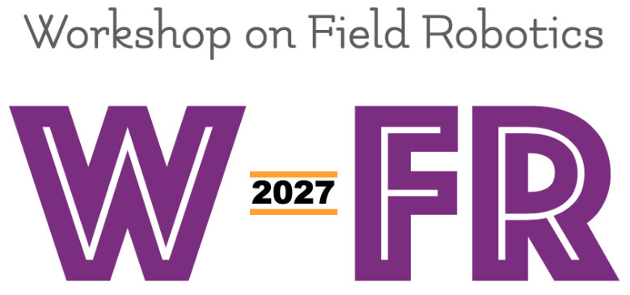
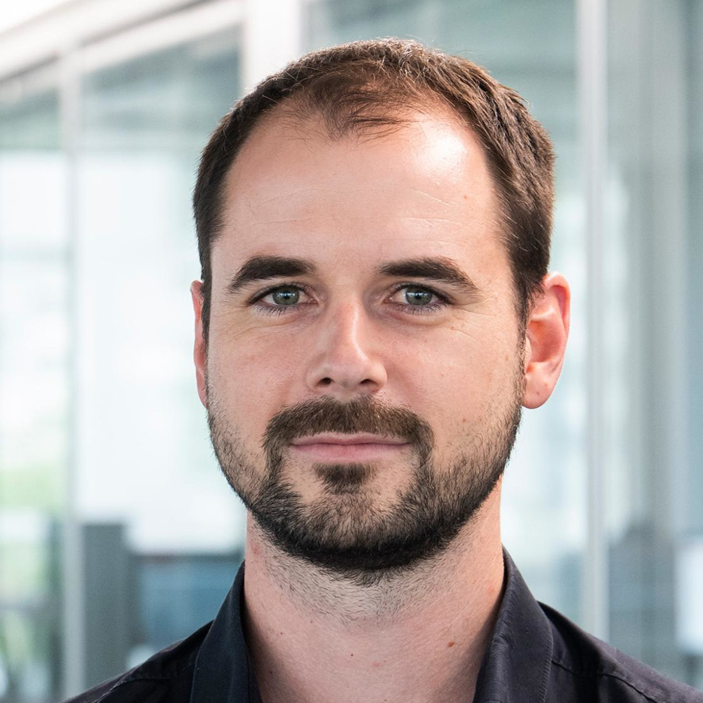
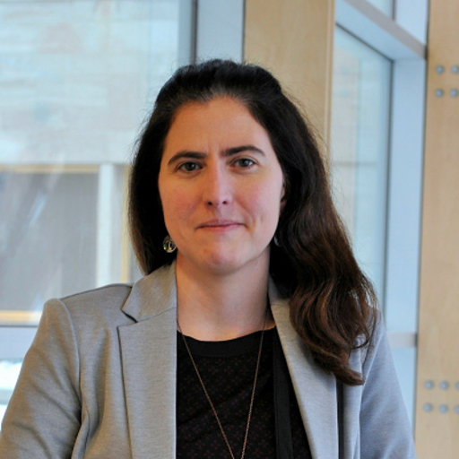

## Important dates

- Submission deadline: April 26, 2027, 11:59 p.m. (Anywhere on Earth)
- Poster notification of acceptance:  May 1st, 2027
- Spotlight talks notification of acceptance: May 7, 2027
- Workshop date: May 24, 2027

The best submissions will be invited to submit a full-length paper in a Special Issue of the [IEEE Transactions on Field Robotics](https://www.ieee-ras.org/publications/t-fr).

- Official Invitations sent: September-October 2027
- Deadline of submission to IEEE T-FR: February 2028

# Context

Field robotics tackles the problem of developing, deploying, and evaluating autonomous mobile systems in unstructured and often dynamic environments. Typical commercial applications are in agriculture, construction, mining, and forestry. The range of physical mediums is also very diversified: in the air, on the ground, underground, on the water, and underwater. These can be located on Earth, or on other celestial bodies (e.g., planets, moons, or asteroids). As such, field robotics works under wildly diverse and radically different assumptions than other areas of robotics, which tend to have well-defined working hypotheses. Therefore, this creates its own set of challenges. This workshop will thus offer the opportunity to present work and discuss how these unique challenges can be solved.

This workshop will bring together experts, researchers, and practitioners to discuss the latest advancements in field robotics. Participants will gain valuable insights into the challenges and opportunities that arise in deploying robots in diverse field scenarios, such as rugged terrains, remote locations, and hazardous environments. Practical case studies and real-world applications will be presented to showcase the successful, and not-so-successful cases of field robotics. The workshop will encourage fruitful dialogues and collaborative discussions, culminating by a panel at the end of the workshop. Attendees will leave with a comprehensive understanding of the state-of-the-art technologies, the main actors, and upcoming challenges. As major outcomes, we aim to consolidate the community around field robotics and prepare an editorial article on the current status of robotics deployed in real environments.

 

# Program

| **Time** | **Speaker** | **Topic/title** |
|---------------------|----------------------------------------|------------------------------------------------------------------------------|
| 8:30 - 8:50 | Organizers | Welcome and opening remarks |
| 8:50 - 9:35 | **James Forbe** (McGill University) | Invited talk #1 (tentative) - **Reliable Localization and Mapping for Underwater Robots in Challenging Environments** |
| 9:35 - 10:00 | 5 emerging researchers | Spotlight talks (4 min/pers) |
| 10:00 - 11:00 | Poster session | - |
| 11:00 - 11:45 | **Martin Magnusson** (Orebro University) | Invited talk #2 (tentative) - **Radars in the Wild: Autonomous navigation in unstructured environments** |
| 11:45 - 12:30 | **Nived Chebrolu** (IIT Bombay) | Invited talk #3 (tentative) - **SLAM in Agricultural Environments: From Crop-Scale Mapping to Long-Term Localization** |
| 12:30 - 14:00 | Lunch | - |
| 14:00 - 15:00 | **Roland Siegwart** (ETH Zurich) | Keynote (tentative) - **30 years of deployments** - **From Robot Design to Navigation and Scene Understanding** |
| 15:00 - 15:35 | Panel Discussion | - |
| 15:35 - 16:00 | 5 emerging researchers | Spotlight talks (4 min/pers) |
| 16:00 - 16:45 | Poster session | - |
| 16:45 - 17:30 | **Teresa Vidal Calleja** (University of Technology Sydney) | Invited talk #4 (tentative) - **Robust Mapping and Localization in Unstructured Environments: From Planetary Exploration to Field Robotics** |
| 17:30 - 18:00 | Organizers | Conclusion |

***Note**: All times are in the local time zone of ICRA 2027 (Seoul)

# Speakers  
<!-- copy paste this for each speaker

    

    
    

      

        <h3>Title of presentation</h3>
        <strong>Name</strong> 
        <em>Affiliation</em>   
        <a href="">Personal website</a>
      

 
end speaker1-->

# Call for contributions

The workshop topics include, but are not limited to:

- Agriculture
- Construction
- Forestry
- Healthcare
- Intelligent Transportation Systems
- Marine Robotics
- Mining
- Search and rescue
- Space exploration

## Submission guidelines

The selection of the participants for the poster sessions will be based on submitted posters, following these criteria:
- Relevance of the contribution with respect to field robotics (e.g., unacceptable would be only simulation, weak would be on a campus, strong would include challenging outdoor and remote locations;
- Evidence of the proposed results based on field experiments (e.g., weak would be a single experiment, strong would be multiple visits to a site or multiple sites);
- Quality of the analysis (e.g., unacceptable would be anecdotal results, weak would be qualitative results or time series, strong would be quantitative results with statistical evidence).
  
- The posters should be submitted on Microsoft CMT.
- Submissions do not need to be anonymized.

In addition to a poster presentation, a subselection of the submitted posters will be made for rapid-fire talks to provide added exposure to emerging researchers (e.g., PhD students, early career professors). This selection will be made based on:
- Current status and affiliation of the first author (must qualify as emerging);
- The potential for visually interesting results;
- Meaningfulness of the lessons learned through field experiments and expert interviews.

# Organizers

    

    
    

      

        <strong>François Pomerleau</strong> 
        <em>Université Laval</em> 
        <a href="https://norlab.ulaval.ca/people/f_pomerleau/">Personal website</a>
      

 

    

    
    

      

        <strong>Su Yeon Choi</strong> 
        <em>Republic of Korea Army Research Center</em>  
        <a href="https://www.linkedin.com/in/su-yeon-choi-9529b51b5/">Personal website</a>
      

 

    

    
    

      

        <strong>Johann Laconte</strong> 
        <em>French National Research Institute for Agriculture, Food and Environment (INRAE)</em>  
        <a href="http://rleaf.mathnum.inrae.fr/people/jlaconte/">Personal website</a>
      

 

    

    
    

      

        <strong>Joshua Mangelson </strong> 
        <em>Brigham Young University</em>  
        <a href="https://ece.byu.edu/directory/josh-mangelson">Personal website</a>
      

 

    

    
    

      

        <strong>Marco Hutter</strong> 
        <em>ETH Zurich</em>  
        <a href="https://rsl.ethz.ch/the-lab/people/person-detail.MTIxOTEx.TGlzdC8yNDQxLC0xNDI1MTk1NzM1.html">Personal website</a>
      

 

 

    

    
    

      

        <strong>Stéphanie Aravecchia</strong> 
        <em> Georgia Tech Europe</em>  
        <a href="https://dream.georgiatech-metz.fr/people/person-detail/saravecchia/">Personal website</a>
      

 

 

    

    
    

      

        <strong>Edith Brotherton</strong> 
        <em>Université Laval</em>  
        <a href="https://norlab.ulaval.ca/people/e_brotherton_fr/">Personal website</a>
      

 

## Previous Editions

- [2026 Workshop on Field Robotics](https://norlab-ulaval.github.io/workshop_field_robotics_icra2026/)
- [2025 Workshop on Field Robotics](https://norlab-ulaval.github.io/workshop_field_robotics_icra2025/)
- [2024 Workshop on Field Robotics](https://norlab-ulaval.github.io/workshop_field_robotics_icra2024/)

The Microsoft CMT service was used for managing the selection process for this workshop. This service was provided for free by Microsoft and they bore all expenses, including costs for Azure cloud services as well as for software development and support.

